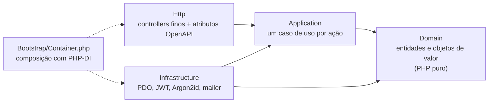

# Goomer Menu API (PHP)

API para um restaurante cadastrar produtos e promoções com dia e hora marcados, e publicar o cardápio do momento.
Se é sexta às 18h30 no fuso do restaurante, o cardápio já sai com o chopp em promoção. Às 20h, a promoção some
sozinha.

É a versão em PHP do desafio técnico da Goomer, a trilha 2 do plano: PHP 8.4, Slim 4, SQL escrito à mão e testes em
quatro níveis. O plano completo, com as mesmas regras em TypeScript e Java, está em
[`docs/visao-geral.md`](docs/visao-geral.md). A versão em TypeScript está em
[jamangueira7/goomer-menu-ts](https://github.com/jamangueira7/goomer-menu-ts).

**Destaques**

- **Cardápio em uma consulta só:** um `LEFT JOIN LATERAL` monta o cardápio, já no fuso de cada restaurante.
- **Regras garantidas duas vezes:** o domínio valida, e o Postgres garante de novo com `CHECK` e `EXCLUDE USING gist`.
  Nem um `INSERT` feito direto no banco consegue criar duas promoções sobrepostas.
- **Domínio em PHP puro:** o Deptrac falha se ele importar o Slim, o PDO, qualquer outra biblioteca ou até a camada
  de aplicação.
- **Log de auditoria em toda escrita:** quem fez, o quê, de/para e IP, gravado na mesma transação da escrita e
  consultável por usuário e período.
- **112 testes:** os de integração usam um Postgres de verdade, e os de ponta a ponta leem o e-mail no Mailpit.
  Cobertura de 100% no domínio e nos casos de uso, com PHPStan no nível máximo.
- **Sobe com um comando:** `docker compose up` cria o banco, roda as migrations e o seed e sobe a API com um admin de
  exemplo.

## Sumário

- [Stack](#stack)
- [Rodando em 1 minuto](#rodando-em-1-minuto)
- [Rotas](#rotas)
- [Passo a passo com curl](#passo-a-passo-com-curl)
- [Arquitetura](#arquitetura)
- [Regras de negócio e decisões](#regras-de-negócio-e-decisões)
- [Testes e qualidade](#testes-e-qualidade)
- [Desafios técnicos](#desafios-técnicos)

## Stack

| Camada | Escolha | Por quê |
| --- | --- | --- |
| Linguagem | PHP 8.4 | `readonly`, enums e `strict_types` deixam o domínio pequeno e seguro |
| HTTP | Slim 4 + PSR-7 | Microframework que não impõe arquitetura, como o desafio pede; um grupo de rotas isola as protegidas |
| Validação | Classe `Input` própria | Lê o corpo sem converter tipos em silêncio e junta os erros por campo para o 422 |
| Injeção de dependência | PHP-DI | Toda a montagem em um arquivo só (`src/Bootstrap/Container.php`) |
| Banco | Postgres 16 + PDO | SQL à mão com parâmetros nomeados e prepare nativo; `btree_gist` para impedir janelas sobrepostas |
| Migrations | Doctrine Migrations | ORM só para o esquema, como o desafio pede; as migrations são SQL escrito à mão |
| Autenticação | JWT HS256 (`firebase/php-jwt`) + Argon2id | Token de 1 hora; senha com o hash recomendado hoje |
| E-mail | symfony/mailer + Mailpit | Recuperação de senha testável na máquina local |
| Documentação | swagger-php + Swagger UI | OpenAPI gerado dos atributos dos controllers, servido em `/docs` |
| Testes | PHPUnit 11 | Quatro níveis, com cobertura de Domain e Application checada por script |

## Rodando em 1 minuto

Só precisa de Docker. Não é preciso ter PHP nem Composer instalados.

```bash
git clone https://github.com/jamangueira7/goomer-menu-php.git && cd goomer-menu-php
docker compose up -d --build
curl -s http://localhost:8090/api/v1/restaurants/1/menu
```

| Endereço | O que é |
| --- | --- |
| http://localhost:8090/api/v1 | API |
| http://localhost:8090/docs | Documentação OpenAPI interativa (só com `APP_ENV=dev`, o padrão) |
| http://localhost:8026 | Mailpit, a caixa de entrada dos e-mails de teste |

O `.env` é opcional, porque o compose já traz valores de desenvolvimento. Para mudar algo, copie o `.env.example`.

**Dados de exemplo criados pelo seed**

- Restaurante 1, "Bar do João", no fuso `America/Sao_Paulo`.
- Admin `admin@bardojoao.com`, senha `goomer123`.
- Happy hour do chopp pela metade do preço, de segunda a sexta, das 18:00 às 20:00.
- Feijoada que só aparece no cardápio aos sábados, das 11:00 às 16:00.

Para criar outro admin: `make create-admin EMAIL=ana@bar.com PASSWORD=segredo123 NAME="Ana"`.

**O que sobe no compose**

| Serviço | O que faz |
| --- | --- |
| `db` | Postgres 16 com healthcheck, sem porta exposta no host (`docker compose exec db psql -U goomer`) |
| `migrate` | Roda as migrations e o seed, e encerra |
| `api` | Sobe só depois que o `migrate` termina com sucesso |
| `mailpit` | Recebe os e-mails por SMTP na porta 1025 |
| `test` | Perfil `test`: ferramentas de qualidade e testes, usando o mesmo Postgres num banco `goomer_test` |

## Rotas

Todas ficam sob `/api/v1`. Só o cardápio e as rotas de login e de recuperação de senha dispensam token. Todas as
outras exigem `Authorization: Bearer <token>` e só enxergam dados do restaurante do usuário logado.

| Método | Rota | O que faz |
| --- | --- | --- |
| `GET` | `/restaurants/{id}/menu` | **Cardápio público**: produtos visíveis e disponíveis agora, por categoria, com a promoção ativa |
| `POST` | `/auth/login` | Troca e-mail e senha por um JWT válido por 1 hora |
| `POST` | `/auth/forgot-password` | Envia o e-mail de redefinição de senha (sempre responde 202) |
| `POST` | `/auth/reset-password` | Define a nova senha com o token do e-mail |
| `GET` `POST` | `/products` | Lista (filtros `category` e `visible`, paginação) e cria produtos |
| `GET` `PUT` `DELETE` | `/products/{id}` | Detalha, altera e exclui um produto |
| `PATCH` | `/products/{id}/visibility` | Mostra ou esconde o produto no cardápio |
| `PUT` | `/products/order` | Define a ordem dos produtos no cardápio |
| `GET` `POST` | `/promotions` | Lista (filtro `productId`) e cria promoções |
| `GET` `PUT` `DELETE` | `/promotions/{id}` | Detalha, altera e exclui uma promoção |
| `GET` `POST` | `/users` | Lista e cria usuários do restaurante |
| `DELETE` | `/users/{id}` | Exclui um usuário |
| `GET` | `/users/{id}/audit-logs` | Log de auditoria do usuário por período (`dateIni`, `dateEnd` opcional, paginação) |

Os erros seguem o [Problem Details (RFC 9457)](https://www.rfc-editor.org/rfc/rfc9457), com o detalhe de cada campo
em `errors`. JSON malformado dá 400, regra de negócio violada dá 422, conflito de horário dá 409, id inexistente ou não
numérico dá 404 e método errado numa rota que existe dá 405.

## Passo a passo com curl

**1. Ver o cardápio, sem token.** Numa quarta-feira às 18:30 em São Paulo, a resposta é esta (resumida):

```json
{
  "restaurant": { "id": 1, "name": "Bar do João", "timezone": "America/Sao_Paulo" },
  "generatedAt": "2026-12-02T18:30:00-03:00",
  "categories": [
    {
      "key": "bebidas",
      "name": "Bebidas",
      "products": [
        {
          "id": 1, "name": "Chopp 300 ml", "price": 1400,
          "promotion": { "description": "Happy hour: chopp pela metade do preço", "price": 700, "endsAt": "20:00" }
        },
        { "id": 2, "name": "Refrigerante lata", "price": 700, "promotion": null }
      ]
    }
  ]
}
```

Preços são inteiros em centavos (`1400` = R$ 14,00). Fora do horário, `promotion` vem `null`.

**2. Entrar e guardar o token.**

```bash
API=http://localhost:8090/api/v1
TOKEN=$(curl -s -X POST $API/auth/login -H 'Content-Type: application/json' \
  -d '{"email":"admin@bardojoao.com","password":"goomer123"}' | sed -E 's/.*"accessToken":"([^"]+)".*/\1/')
```

**3. Criar um produto que só é vendido às sextas à noite.** Dias da semana vão de 0 (domingo) a 6 (sábado). As
categorias são `entradas`, `pratos_principais`, `sobremesas` e `bebidas`.

```bash
curl -s -X POST $API/products -H "Authorization: Bearer $TOKEN" -H 'Content-Type: application/json' \
  -d '{"name":"Caipirinha","price":2200,"category":"bebidas","availability":[{"weekday":5,"start":"17:00","end":"23:45"}]}'
```

**4. Criar uma promoção para ele.** Use o `id` devolvido no passo anterior. A API responde 409 se o horário se
sobrepuser a outra promoção do mesmo produto, e 422 se o preço não for menor que o normal.

```bash
curl -s -X POST $API/promotions -H "Authorization: Bearer $TOKEN" -H 'Content-Type: application/json' \
  -d '{"productId":8,"description":"Sexta da caipirinha","price":1500,"windows":[{"weekday":5,"start":"18:00","end":"20:00"}]}'
```

**5. Filtrar, paginar e ordenar.**

```bash
curl -s "$API/products?category=bebidas&visible=true&page=1&perPage=20" -H "Authorization: Bearer $TOKEN"
curl -s -X PUT $API/products/order -H "Authorization: Bearer $TOKEN" -H 'Content-Type: application/json' -d '{"ids":[2,1]}'
```

**6. Ver o log de auditoria do admin.** Toda escrita acima ficou registrada com o de/para, o IP e a hora local.
`dateIni` é obrigatório; sem `dateEnd`, a consulta vai até agora. Os dias valem no fuso do restaurante.

```bash
curl -s "$API/users/1/audit-logs?dateIni=$(date +%F)" -H "Authorization: Bearer $TOKEN"
curl -s "$API/users/1/audit-logs?dateIni=2026-11-25&dateEnd=2026-11-26&page=1&perPage=50" -H "Authorization: Bearer $TOKEN"
```

Cada item traz `action` (ex.: `promotion.created`), `entityType`, `entityId`, `changes`, `ip` e `createdAt` (resumido):

```json
{
  "data": [
    {
      "id": 1, "action": "product.created", "entityType": "product", "entityId": 8,
      "changes": { "after": { "name": "Caipirinha", "price": 2200, "category": "bebidas", "visible": true } },
      "ip": "172.29.0.1", "createdAt": "2026-11-26T10:38:44-03:00"
    }
  ],
  "user": { "id": 1, "email": "admin@bardojoao.com" },
  "meta": { "page": 1, "perPage": 50, "total": 1 }
}
```

Senha, hash e tokens nunca entram no log.

### Recuperar a senha pelo Mailpit

Como o projeto não tem front-end, o link do e-mail não abre nenhuma tela. Copie o token do link e envie para a API:

```bash
curl -s -X POST $API/auth/forgot-password -H 'Content-Type: application/json' -d '{"email":"admin@bardojoao.com"}'
# Abra http://localhost:8026, veja o e-mail "Redefinição de senha" e copie o valor de token=...

curl -s -o /dev/null -w '%{http_code}\n' -X POST $API/auth/reset-password -H 'Content-Type: application/json' \
  -d '{"token":"COLE_O_TOKEN_AQUI","password":"nova-senha-123"}'   # 204; 422 se usado, vencido ou inválido
```

Para pegar o token sem abrir o navegador, use a API do Mailpit:

```bash
curl -s "http://localhost:8026/api/v1/search?query=to:admin@bardojoao.com" \
  | sed -E 's/.*"ID":"([^"]+)".*/\1/' | xargs -I{} curl -s http://localhost:8026/api/v1/message/{} \
  | grep -oE 'token=[a-f0-9]{64}' | head -1 | cut -d= -f2
```

Mais de 5 pedidos para o mesmo e-mail ou IP em 15 minutos recebem 429, com o cabeçalho `Retry-After`.

## Arquitetura

Cada módulo (`Product`, `Promotion`, `Menu`, `Auth`, `User`) tem as mesmas quatro camadas, e as dependências só
apontam para dentro:



```
src/<Módulo>/Domain           entidades, objetos de valor e interfaces de repositório
src/<Módulo>/Application      casos de uso (CreatePromotionUseCase, GetMenuUseCase...) com DTOs de entrada e saída
src/<Módulo>/Infrastructure   implementações com PDO, JWT, Argon2id e symfony/mailer
src/<Módulo>/Http             controllers e atributos OpenAPI
src/Shared/Domain             Money, Weekday, TimeOfDay, TimeWindow, Timezone, Clock, DateRange
src/Shared/Application        Actor, Auditor, AuditLog e TransactionManager (as portas da auditoria)
src/Shared/Infrastructure     Database (PDO), PdoAuditLog e PdoTransactionManager
src/Shared/Http               rotas, Problem Details e leitura do corpo (Input)
src/Bootstrap/Container.php   único ponto de composição (PHP-DI)
migrations/                   Doctrine Migrations com SQL escrito à mão
```

- **Domain** dá para testar só com `new`, sem banco nem framework. O Deptrac garante isso a cada `make lint`, junto
  com as outras regras de camada: Application não conhece Infrastructure nem Http, e os controllers não conhecem a
  Infrastructure.
- **A hora vem de um `Clock` injetável.** O caso de uso pega o "agora", converte para o fuso do restaurante
  (`Timezone::localize`) e passa dia e hora locais para a consulta. Nos testes, o relógio é fixo.
- **O banco é a segunda linha de defesa:** `ENUM` de categoria, `CHECK` nos horários, `EXCLUDE USING gist` contra
  janelas sobrepostas, `ON DELETE CASCADE` e e-mail único.
- **Um único guarda JWT:** as rotas protegidas ficam num grupo do Slim com o `JwtMiddleware`; as públicas ficam fora
  dele, sem lista de exceções.

## Regras de negócio e decisões

O enunciado deixa alguns pontos em aberto. Estas foram as decisões, iguais nas três versões do projeto:

| Situação | O que a API faz |
| --- | --- |
| "Intervalo mínimo de 15 minutos" | Minutos só em 00, 15, 30 ou 45, e o fim pelo menos 15 minutos depois do início. A maior janela vai até 23:45 |
| Promoção que vira a meia-noite (22:00 às 02:00) | Recusa com 422. Basta cadastrar uma janela em cada dia |
| Duas promoções do mesmo produto no mesmo horário | Recusa com 409. Janelas que só se encostam (18:00–20:00 e 20:00–21:00) são aceitas |
| Preço promocional maior ou igual ao normal | Recusa com 422. Se o preço normal cair depois, a promoção só é revalidada no próximo `PUT` |
| Horário de disponibilidade do produto | Janelas opcionais; sem janela, o produto está sempre disponível |
| Preço | Inteiro em centavos e um objeto de valor `Money`, nunca ponto flutuante |
| Excluir produto que tem promoção | As promoções dele são excluídas junto, e o log registra quantas foram |
| Troca de senha | Tokens JWT antigos continuam válidos até vencer, no máximo 1 hora |
| `"price": "10"` (texto no lugar de número) | 422. A leitura do corpo não converte tipos em silêncio |
| Log de auditoria | Uma linha por escrita, na mesma transação: se o log falha, a escrita é desfeita |
| Autor do log | `actor_user_id` sem chave estrangeira, para o log sobreviver à exclusão do usuário; o e-mail é copiado na hora |
| Período do log | Dias inclusivos no fuso do restaurante; sem `dateEnd`, vai até agora |

## Testes e qualidade

| Nível | Pasta | Testes | O que cobre |
| --- | --- | --- | --- |
| Unitário | `tests/Unit` | 39 | Regras do domínio, sem banco, em milissegundos |
| Caso de uso | `tests/UseCase` | 37 | Repositórios em memória e relógio fixo em fusos diferentes |
| Integração | `tests/Integration` | 18 | Repositórios PDO contra o Postgres real, incluindo o `EXCLUDE`, os `CHECK` e o rollback do log |
| Ponta a ponta | `tests/E2E` | 18 | App inteira, banco de teste e Mailpit de verdade (o token sai do e-mail) |

A mesma coleção de ponta a ponta foi portada para a versão TypeScript, com as mesmas rotas, códigos e mensagens. É o
critério de aceite comum às trilhas.

| Comando | O que faz |
| --- | --- |
| `make test` | Roda todos os testes |
| `make test-unit` / `make test-integration` | Só unitário e caso de uso / só integração e ponta a ponta |
| `make lint` | Pint (estilo), PHPStan no nível max e Deptrac (camadas) |
| `make coverage` | Gera a cobertura e falha se Domain ou Application ficarem abaixo de 90% |
| `make up` / `make down` / `make logs` | Sobe, derruba e acompanha a API |

Sem `make`, os mesmos comandos rodam pelo compose. Por exemplo:
`docker compose --profile test run --rm test vendor/bin/phpunit`.

Resultado atual: cobertura de linhas de 100% no domínio e nos casos de uso, PHPStan no nível max, Pint e Deptrac sem
pendências.

## Desafios técnicos

**Testar com Postgres real sem Testcontainers.** O PHP não tem um Testcontainers maduro. Os testes usam o próprio
Postgres do compose num banco separado, `goomer_test`, que o bootstrap cria e migra uma vez por execução e limpa a
cada teste. Por segurança, ele se recusa a rodar em banco cujo nome não termine em `_test`
(`tests/Support/TestDatabase.php`).

**Cardápio determinístico.** Os testes de ponta a ponta mandam requisições PSR-7 direto para a app Slim, montada com o
container real (mesmas rotas, middlewares e banco). Só o `Clock` é trocado por um relógio fixo em "quarta-feira, 18:30
em São Paulo", então o resultado não depende da hora em que a suíte roda.

**Impedir sobreposição no próprio banco.** Para usar horários num índice GiST, criei a função `minute_of_day(time)`
como `IMMUTABLE` e indexei `int4range(início, fim)` com `EXCLUDE USING gist`. Se duas requisições chegarem juntas e
passarem pela validação da aplicação, o banco recusa a segunda, e o repositório traduz o erro `23P01` para o mesmo 409.

**Parâmetro repetido no SQL.** Com prepare nativo do PDO (`ATTR_EMULATE_PREPARES=false`), o mesmo `:nome` não pode
aparecer duas vezes. A consulta do cardápio calcula dia e hora uma vez só, numa CTE (`now_local`).

**Entidade que já nasce com id.** Os repositórios pedem o próximo valor da sequência (`nextId()`) antes de salvar, e a
entidade não precisa de setter de id.

**Auditoria na mesma transação, sem mexer nos repositórios.** Cada caso de uso de escrita roda a mudança e o
`Auditor::record()` dentro de `TransactionManager::run`. Como os repositórios e o log usam a mesma conexão PDO, e o
`Database::transactional` reaproveita uma transação já aberta, os repositórios continuam iguais. Um teste de integração
força o INSERT do log a falhar (IP inválido para `inet`) e confere que o produto também não foi gravado.

**Quem fez, sem o domínio saber de HTTP.** O `CurrentActor` monta um `Actor` com o usuário e o restaurante do token, o
e-mail atual do usuário e o IP da requisição, e os casos de uso recebem esse `Actor` no lugar do id do restaurante. Se
o usuário do token já foi excluído, a escrita responde 401. No seed e no `create-admin` não há ninguém logado, então
o usuário recém-criado assina a própria entrada.

**Dia local, guardado em instantes.** O `DateRange` transforma `dateIni` e `dateEnd` em dois instantes absolutos no
fuso do restaurante, com o fim exclusivo: `dateEnd=26` vira "antes de 27 às 00:00". A consulta compara `created_at`
(`timestamptz`) com esses instantes, então funciona igual para São Paulo, Tóquio ou dias de troca de horário.

**Limite de pedidos sem revelar quem tem conta.** Cada pedido de recuperação de senha fica registrado com e-mail, IP e
horário. O limite de 429 vale exista ou não o e-mail, e a resposta é sempre 202, para não revelar quem está cadastrado.
Um novo pedido invalida os tokens anteriores ainda abertos.

**Outras escolhas**

- **Servidor da imagem:** o servidor embutido do PHP com 4 workers, em vez de nginx + php-fpm. Basta para um projeto
  de estudo e mantém o compose simples; em produção, o caminho seria FrankenPHP ou php-fpm.
- **Ordem das chaves no log:** o `jsonb` do Postgres reordena as chaves. A API devolve `before` antes de `after`, mas os
  campos dentro de cada um saem na ordem do banco.
- **firebase/php-jwt 7:** o Composer barrou a linha 6.x por um alerta de segurança; a API da biblioteca é a mesma.
- **Portas:** a API usa a 8090 e o Mailpit a 8026, e a versão TypeScript usa 8091 e 8027, então as duas rodam juntas.
